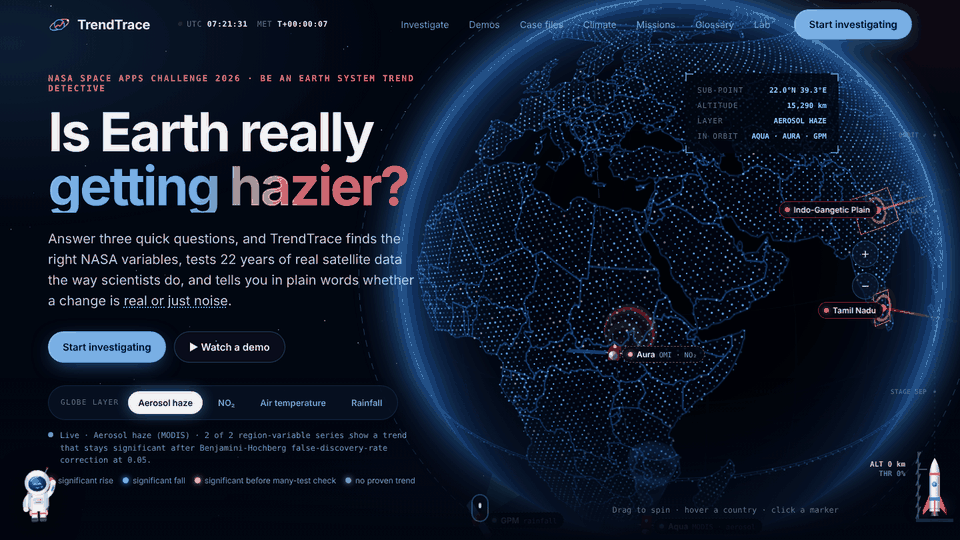
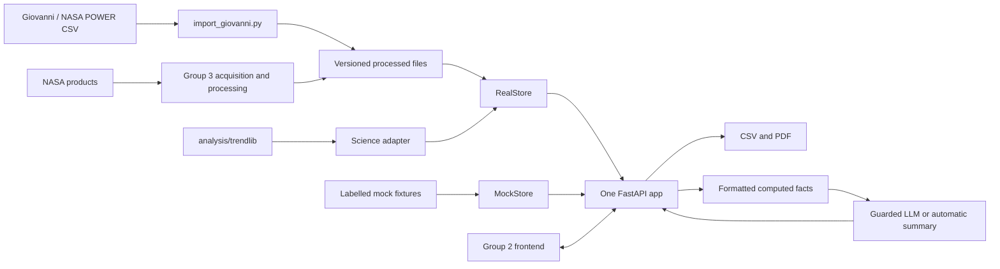

<div align="center">

<a href="https://trendtrace-api-staging-8ars.onrender.com"></a>


<p>
<a href="https://trendtrace-api-staging-8ars.onrender.com"></a>
<a href="https://github.com/adrian-hue-pixel/TrendTrace/actions"></a>


</p>

**NASA Space Apps Challenge 2026 · "Be An Earth System Trend Detective!" · Team Copernicus**

</div>


### 👋 Meet TrendTrace

TrendTrace helps students and the public become **data detectives**. Answer three quick questions, and it finds the right NASA variables, tests 22 years of real satellite data the way scientists do, and tells you in plain words **what** is changing, **where**, **how much**, and whether the change is **statistically significant** or just noise.

*Trace, our astronaut guide, shows you around the site.*

<br clear="right">

## 🎬 See it in action

<div align="center">
<a href="https://trendtrace-api-staging-8ars.onrender.com"></a>
<sub>Recorded from the real app: 3D globe with country names → Los Angeles case file → warming stripes → the 3-question investigation and a live trend test.</sub>
</div>

## 🛰️ How it works


## 📊 What we found





> TrendTrace shows statistical patterns, not causes. AOD is haze in the whole air column, not ground-level PM2.5. Not an official NASA product, and not endorsed by NASA.


## ✅ How it answers the challenge

| The challenge asks | TrendTrace does it with |
|---|---|
| Identify variables that could show change | `GET /catalog`: 21 variables from MODIS, OMI, AIRS, GPM, MERRA-2, GLDAS and GRACE, each with a plain-language definition, why it trends and its caveat |
| Short questions about what/where to investigate | `GET /discover/questions` + `POST /discover`: guided questions and a transparent recommender that explains every suggestion (desert, rain forest, tidal estuary, city air...) |
| Acquire data for a region | Region boxes and presets; `scripts/fetch_nasa_power.py` (real NASA data, no login) and `scripts/import_giovanni.py` (any Giovanni area-averaged CSV) |
| Time series + visualisation | `GET /timeseries`, `POST /analyze/detail` (chart-ready series, fitted Theil–Sen line and uncertainty band) |
| Rate of change and significance (t-test, Mann–Kendall, CIs) | `trendlib`: deseasonalised Hamed–Rao modified Mann–Kendall, Theil–Sen slope per decade with interval, OLS t-test and CI, sensitivity runs, evidence label |
| What / where / how much, across many series | `GET /scan`: every region × variable, Benjamini–Hochberg FDR q-values, ranked headlines, and opposite-direction trends flagged |
| "Finding a trend is interesting even if not significant" | Years-to-detect estimate (Weatherhead et al. 1998) and Pettitt step-change test |
| Any variable, today | `POST /analyze/series`: upload a Giovanni CSV or any series and get the full analysis |
| Demonstration examples | `GET /demos` + `python scripts/run_demo.py`: five walkthroughs, two on **real** NASA-derived series |

**Data status: REAL.** The app serves Group 3's observed NASA data: 12 Giovanni exports for 2003–2024 (GPM IMERG V07 rainfall, Aqua MODIS C6.1 AOD, with Terra MODIS and MERRA-2 as comparison series) over the Indo-Gangetic Plain and Tamil Nadu boxes. Sritharan's full pipeline, raw exports and results live in `group3_pipeline/`, and `python scripts/build_real_data.py` turns them into `data/processed/`. Headline results (monthly, seasonal cycle removed): AOD rises **+0.083 per decade over the Indo-Gangetic Plain (+15.7%/decade)** and **+0.049 per decade over Tamil Nadu (+15.9%/decade)**, both p < 0.001 with an evidence label of "strong" (Terra MODIS and MERRA-2 agree in sign). Rainfall shows no significant trend in either box in IMERG, although the MERRA-2-based NASA POWER rainfall rises over the Indo-Gangetic Plain (a product disagreement the evidence label exposes). Extra NASA POWER series (fetched by `.github/workflows/fetch-nasa-data.yml`, listed in `data/raw/imports.json`) add air temperature for IGP, TN, Delhi, Los Angeles and the southern Amazon (+0.64 °C/decade, p < 0.001) and Sahel rainfall (+1.0 mm/month per decade, p < 0.001). OMI NO₂ (daily Giovanni downloads averaged to months with measured coverage): **Los Angeles −51.5% per decade (p < 0.001, strong)** while **Delhi shows no significant all-year trend (−4.2% per decade, p = 0.27)**; only Delhi's October–December season falls significantly (−11% per decade). The labelled mock fixtures remain for tests (`DATA_MODE=mock`).

The backend runs without an AI key. See [docs/challenge-audit.md](docs/challenge-audit.md) for the full review of what changed and what is still open.

## Architecture



Every statistic lives in `analysis/trendlib` (implementing Group 3's handbook protocol); scientific unit conversion belongs to the processing step. The backend loads, validates, selects and serves; it never fills gaps, smooths or interpolates, and routers never compute statistics themselves. CSV, PDF and core API use the same store methods. There is no database, authentication service, Docker requirement or queue.

## Setup — Python 3.11

Run commands from the extracted repository root (`TRENDTRACE`, containing this README). Create a fresh environment; virtual environments are not portable between computers.

### macOS / Linux

```bash
python3.11 -m venv .venv
source .venv/bin/activate
python -m pip install -r requirements.txt -c requirements.lock
python -m pip install -r requirements-dev.txt -c requirements.lock
python -m uvicorn app.main:app --app-dir backend --port 8000
```

### Windows PowerShell

```powershell
py -3.11 -m venv .venv
.\.venv\Scripts\Activate.ps1
python -m pip install -r requirements.txt -c requirements.lock
python -m pip install -r requirements-dev.txt -c requirements.lock
python -m uvicorn app.main:app --app-dir backend --port 8000
```

Open http://127.0.0.1:8000/ for the simple web app (plain HTML/JS in `frontend/`, no build step) or http://127.0.0.1:8000/docs for the API. No `.env` or AI key is required for mock mode. Tests/QA tools are in requirements-dev.txt; deployment uses requirements.txt.

For a first check in `/docs`, run `GET /api/v1/health`, then `POST /api/v1/analyze` with the example below. Send its `result_id` to `/explain` for an automatic summary. The displayed `data_status` must remain `mock` throughout this development journey.

Optional local configuration:

```bash
cp .env.example .env
```

PowerShell: `Copy-Item .env.example .env`. Actual environment variables override `.env`. Keep keys only in the private `.env` or deployment secrets. All direct dependencies are pinned; `.python-version` is 3.11.

Mock fixtures are already included. To regenerate them after changing the single region/variable registry in `scripts/mock_config.json`:

```bash
python scripts/generate_mock_data.py
python scripts/generate_load_fixture.py
```

## Data modes and real-science installation

| APP_ENV | DATA_MODE | Behaviour |
|---|---|---|
| dev | mock | Serves labelled data/mock/<scenario> fixtures. |
| dev | real | Loads Group 3 files. Missing assets return DATA_NOT_AVAILABLE; never falls back to mocks. |
| prod | real | Requires real metadata/monthly files and consistent provenance for every loaded asset. |
| prod | mock | Refuses to start. |

`MOCK_SCENARIO` is normal, sparse (about 40% monthly values missing), or short (under ten years). Real mode ignores it. DATA_VERSION can pin a release, and CONTRACT_VERSION defaults to 1.0.

`analysis/trendlib` ships in this repository and is imported automatically (no extra install; deployment needs no change). Optionally install it as a package:

```bash
python -m pip install -e analysis
``` For real mode, place Group 3's files under `data/processed/` and follow [the loader layout](docs/implementation/real-data-layout.md): metadata envelopes, monthly/daily CSV, manifest provenance and later results. Restart after each data release; the loader reads files once at startup. Missing optional H7/H9 results remain unavailable.

macOS/Linux real-mode start:

```bash
APP_ENV=dev DATA_MODE=real python -m uvicorn app.main:app --app-dir backend --port 8000
```

PowerShell equivalent:

```powershell
$env:APP_ENV="dev"
$env:DATA_MODE="real"
python -m uvicorn app.main:app --app-dir backend --port 8000
```

Set APP_ENV=prod only when the required real assets are delivered and validated. Caches are per process and data release. For this MVP use one worker so the in-memory explanation rate limit is shared by all requests handled by the service.

## API

Base path: `/api/v1`. Every successful JSON response has `{data_status,data_version,contract_version,generated_at,result}`. Errors use `{error:{code,message,details}}`. PDF/CSV downloads use their own content types. Full schemas are in `/docs` and [contract A–J](docs/contract.md).

| Method | Path | Purpose |
|---|---|---|
| GET | /health | Liveness, loaded data version, installed trendlib version and key-presence indicator. No provider probe. |
| GET | /variables | Variable IDs, units, sources and descriptions. |
| GET | /regions | Region metadata and GeoJSON boxes. |
| GET | /meta/sources | Dataset provenance. |
| GET | /timeseries | Series selected by region, variable, frequency, period and optional source. |
| POST | /analyze | A validated TrendResult including evidence. |
| POST | /compare | Trends for 2–4 regions, or rainfall/AOD for one region plus stored association. |
| GET | /anomalies | Rainfall, AOD or combined unusual-month results. |
| GET | /rainfall/indicators | Heavy-rain share, longest dry spell or Rx5day. |
| GET | /interaction | Rain-event comparison, sampling percentages and association warning. |
| POST | /explain | Guarded explanation or deterministic automatic summary. |
| GET | /export/csv | Exact series/trend/anomaly values with comment metadata. |
| POST | /report | Create the Discovery Report; return its ID/download URL. |
| GET | /report/{report_id} | Download the generated PDF. |
| GET | /catalog | Variable catalogue: plain definitions, missions, products, Giovanni IDs, region presets, `available_now`. |
| GET | /discover/questions | Guided question flow (theme, place type, free-text question, region). |
| POST | /discover | Ranked variable suggestions with reasons and the next step (analyse now, or download from Giovanni). |
| GET | /demos | Watchable demo walkthroughs (steps, narration, what to notice). |
| GET | /research/series[/{id}] | Real annual NASA-derived series from Group 3's research export. |
| POST | /analyze/detail | Trend plus chart fit/band, change point, years-to-detect and a plain-language summary. |
| POST | /analyze/series | Analyse a research series, an inline series or a Giovanni CSV (`giovanni_csv`, optional `conversion`). |
| GET | /scan | All regions × variables with FDR q-values, headlines and opposite-direction flags. |

Web app: `/` (plain HTML/JS in `frontend/`, no build step). It opens with a 3-question "data detective" flow (what, what kind of place, your question) that suggests NASA variables with plain definitions and tests live ones in one click, plus watchable step-by-step demos and a glossary of the statistics words. The landing page has a 3D globe (`globe.js`, three.js vendored in `frontend/vendor/`): drag to spin, hover a country for its name, hover or click a marker for its live trend, and switch layers (aerosol, NO₂, air temperature, rainfall). Six scroll-driven case files fly the globe to each finding. Mission theme: Aqua, Aura and GPM orbit the globe, a rocket climbs the page as you scroll (desktop), Trace the astronaut guide waves hello and gives tips, "Climate pulse" draws warming stripes live from the engine, and "Earth's vital signs" lists all 21 variables by theme. Below it, the lab: Analyze, What's changing, Discover, Unusual months & rain (anomalies, indicators, rain–haze interaction), Real data & upload, Demos. Deep links: `/#lab=DELHI:no2` runs an analysis, `/#more=interaction` opens a view. After the data changes, run `python scripts/build_globe_snapshot.py` so the globe's first paint matches (a test checks it). Motion respects the reduced-motion setting; phones keep normal page scrolling.

Analyze request example:

```json
{"region_id":"IGP","variable":"aod","start":"2003-01","end":"2024-12","season":"all","options":{"alpha":0.05,"exclude_low_coverage":false}}
```

Core seasons: all, JF, MAM, JJAS, OND. Period parameters are YYYY-MM. Omit an optional date to select the available boundary; an empty date is an INVALID_PERIOD error. A trend requires ten years and at least 70% valid expected observations in the selected season, including when selected for a PDF. Daily series requests are limited to ten years per call. Null values remain null, and genuine zeros remain zeros.

Comparison examples:

```json
{"mode":"regions","region_ids":["IGP","TN"],"variable":"aod"}
```

```json
{"mode":"variables","region_id":"IGP","variables":["rainfall","aod"]}
```

Comparisons use one common period. same_direction is null unless every compared trend is significant. A stored monthly association for another period is not attached to the requested period.

In both mock and real mode `trendlib` computes every valid selection (any season, period of at least ten years, alpha 0.01/0.05/0.10, exclude_low_coverage). Mock results carry a first limitation line saying they are computed on illustrative data. The stored mock trend fixtures are used only if trendlib cannot be imported. Result IDs carry `_a0.10` / `_xlc` suffixes for non-default options so explanations never confuse two analyses. An omitted start/end defaults to the variable's own observed record.

## Explanations and AI disclosure

Prefer a server-known ID:

```json
{"result_type":"trend","result_id":"trend_IGP_aod_all_2003-01_2024-12"}
```

Alternatively send `{result_type,result}`. Allowed result types are trend, anomaly, interaction and summary. Inline results are schema-validated, not independently authenticated as Group 3 science, and never populate the verified-ID registry. Summary input is provisionally `{results:[existing scientific objects]}` (up to eight) or CompareResult. Large anomaly payloads should use IDs to stay within MAX_BODY_BYTES.

Output is `{text,key_points,caveats,source,guardrail:{passed,issues}}` inside the standard envelope. Group 2 displays these exact labels:

- source=llm: **AI-generated explanation of computed results**
- source=template: **Automatic summary**

Numbers are formatted in code before generation: AOD to three decimals, rainfall to one, p-values to three decimals or p < 0.001. The LLM never computes/estimates a value. Deterministic checks reject unsupported numeric strings or changed p-value relations, causal language, incorrect significance, missing limitations, links/active URI text, overlong output and AOD/PM2.5 equivalence. Guardrails also check fallback templates. passed refers to the text actually served; issues records why provider text was bypassed/rejected.

With empty LLM_API_KEY the template path is fully usable and /health reports ai_available=false. To enable the optional provider, set LLM_PROVIDER to `groq` (recommended: free tier, OpenAI-compatible, does not train on API data; e.g. LLM_MODEL=openai/gpt-oss-120b), `gemini` (free tier through Google AI Studio's OpenAI-compatible endpoint; free-tier prompts may be used for training) or `openai` (paid), choose a model that supports JSON mode, and set the private key in Render's Environment tab only. Each provider uses a fixed HTTPS origin; any other value falls back to the automatic summary. The provider supports a model with JSON mode and temperature 0.1; unsupported model/parameter/provider responses fall back. No paid model is selected automatically. Provider failures, malformed JSON, timeouts and rejected output use deterministic templates. Template failure returns AI_UNAVAILABLE; admission overload also uses that code with Retry-After, as described below.

Explanation requests are limited to ten per minute per direct client IP, including cache hits, and four concurrent explanation requests per process. Excess concurrent requests return AI_UNAVAILABLE with Retry-After; quota exhaustion returns RATE_LIMITED. The slot remains held until the response has been generated. Trusted proxy configuration must be set by the deployment owner; the app does not read caller-supplied X-Forwarded-For itself. Facts-hash caches and rate limits are bounded in memory. The existing PDF summary hook reuses guarded cached explanations or renders an immediate template; it never starts a new provider request while building the report. Direct script PDF summaries are template-only.

**AI in the app:** optional wording of already computed, validated results. **AI in development:** backend code, tests and documentation were AI-assisted (Codex for Adrian's changes; Karnish's handoff describes prior Claude-assisted work). Scientific/release review remains the team's responsibility. No AI-generated observations are used as NASA evidence. Group 3 should incorporate the team's full AI-use inventory in the submission disclosure. The key owner must meet the provider's terms and age requirements.

## CSV, PDF, deployment and fallback

Karnish's contributed run/download/deployment guidance is integrated here; his original contribution remains in [readme_section_for_adrian.md](docs/handoff/readme_section_for_adrian.md).

CSV contains # metadata lines, then contract columns. Load with `pandas.read_csv(path, comment='#')`. Empty cells become missing values; they are never replaced by zero. For exact restoration of escaped special text characters, booleans and nested JSON cells:

```bash
python scripts/decode_csv.py downloaded.csv --json decoded.json
```

Generate a sample report:

```bash
python scripts/make_sample_report.py
```

Reports go in git-ignored `reports/`. POST /report returns a URL for GET /report/{report_id}. The PDF uses the same selected result objects, data version and units as the API. Mock reports are visibly labelled; real reports reject unintended development placeholders. Deployment filesystem storage can be ephemeral; recreate a report after a restart. CSV remains independent if the PDF stack fails.

On each save, cleanup removes other reports older than an hour and keeps at most 200 files, including the new report. An unknown or removed ID returns REPORT_NOT_FOUND; create the report again. A cleanup scan failure is logged and does not invalidate a PDF that was saved successfully.

Hosting configuration and staging details are in [docs/deploy.md](docs/deploy.md). Public deployment itself remains Karnish's responsibility; no remote deployment is performed by this delivery. Run against a local/deployed service:

```bash
python scripts/smoke_test.py http://127.0.0.1:8000 --expect-status mock
```

For real data use --expect-status real; --allow-unavailable permits specified pending advanced/science results. Full release checks require all needed G3 inputs. Operational checks include /analyze under two seconds and a one-region PDF under ten seconds; local mock results do not verify the deployment host's real-data performance.

Build the validated real-data static fallback:

```bash
python scripts/export_static_snapshot.py --require-real
```

For labelled development snapshots omit --require-real. This creates `snapshot/` containing saved responses, CSVs, PDFs and a manifest. Group 2 hosts it alongside the frontend build. PDF failures leave the printable frontend report and CSV available. Snapshot output and generated PDFs are not committed.

## Data sources, methods and limitations

Planned core inputs: NASA GPM IMERG Final V07 rainfall and MODIS Aqua C6.1 AOD at 550 nm. Terra MODIS and MERRA-2 are optional cross-checks, not replacements blended into the primary series. Actual product identifiers, DOIs, citations and access dates come from Group 3's sources/provenance files; mock placeholders are not citations to results.

**Group 3 research integrated:** [docs/methods.md](docs/methods.md) now records the processing definitions reported by Sritharan and the statistical protocol proposed by Aadarsh, with source page/slide references and limitations. Their supplied PDF/PPTX do not contain the separate full-precision export/code/provenance/reference package. This documentation is not proof that the statistical calculations have run or received sign-off. See [source review and exact missing-package checklist](docs/research/group3-handoff-review.md).

The observations described use IGP [76,24,88,30] and TN [76.5,8,80.5,13.5], with 2003–2024 as the intended common record. The deck names Aqua combined AOD SDS AOD_550_Dark_Target_Deep_Blue_Combined_Mean_Mean (monthly) and AOD_550_Dark_Target_Deep_Blue_Combined_Mean (daily). Exact file metadata/provenance must still accompany the export. Baseline eligibility (15 versus earlier10), raw-p/FDR policy, seasonal-year counts and the executable function signature remain decisions, not silently changed public semantics.

AOD is a column optical measurement, **not ground-level PM2.5**. Satellite AOD is retrieved in clear skies; rainy/cloudy periods are under-sampled. Record length, missing observations, sensor drift, and approximate regional boxes limit interpretation. Interaction means association, never causation. Non-significant slopes are never labelled increasing/decreasing. Evidence labels are team rules displayed with their supporting values, not official NASA confidence scores.

Results computed from NASA data by the TrendTrace team are not an official NASA product. Mock development files are illustrative and contain no scientific findings.

## Statistics engine (analysis/trendlib)

| Step | Method | Why |
|---|---|---|
| Seasonal cycle | `season=all`: subtract each calendar month's mean; seasons: one mean per year from complete seasons only | Trends are hidden by the seasonal cycle (challenge note); partial seasons would bias the mean |
| Time axis | Actual decimal years; gaps stay gaps | Missing months must not compress time |
| Significance | Hamed–Rao (1998) modified Mann–Kendall, gap-aware rank autocorrelation | Monthly climate data are autocorrelated; the plain test overstates significance |
| Rate | Theil–Sen slope per decade; Gilbert interval built from the corrected variance | Robust to outliers; interval agrees with the corrected p-value |
| Parametric check | OLS slope, t-test, confidence interval | The t-test the challenge names |
| Robustness | Low-coverage exclusion, end-2021, Seasonal Kendall, OLS; evidence rule v1 | Team evidence labels with their supporting numbers |
| Many tests | Benjamini–Hochberg FDR in `/scan` | Testing many series raises false positives |
| Not significant yet | Weatherhead et al. (1998) years-to-detect (90% power) | "Sometimes all a trend needs is a longer period" |
| Step changes | Pettitt (1979) on Sen-detrended residuals | Flags abrupt shifts (sensor change, regime shift) beyond the trend |

Verified in `backend/tests/test_trendlib.py` against pymannkendall (Mann–Kendall/Hamed–Rao, 1e-9) and SciPy (OLS, t and normal distributions). SciPy is not a dependency because the Python 3.11 pin predates SciPy's current release.

## Getting more NASA data

```bash
# Real NASA data with no login (MERRA-2/CERES-based POWER), any box on Earth:
python scripts/fetch_nasa_power.py --bbox 76 24 88 30 --parameter T2M -o data/raw/IGP_T2M.csv
# Or download "Time Series, Area-Averaged" CSV from https://giovanni.gsfc.nasa.gov (MODIS, OMI, AIRS, GPM, MERRA-2, GLDAS)
# Analyse immediately (POST /api/v1/analyze/series with giovanni_csv), or load into real mode:
python scripts/import_giovanni.py data/raw/IGP_T2M.csv --region-id IGP --variable air_temperature --unit degC
APP_ENV=dev DATA_MODE=real python -m uvicorn app.main:app --app-dir backend --port 8000
```

Imported catalogue variables keep unknown temporal coverage empty (never filled with 1). The frozen rainfall/AOD units and Group 3's coverage rules are unchanged.

## Demos

```bash
python scripts/run_demo.py http://127.0.0.1:8000              # plays all demos in the terminal
python scripts/run_demo.py http://127.0.0.1:8000 haze_rising --pause 2
```

## Large-file QA fixture

`data/mock/qa_large/daily.csv` contains **48,216 generated MOCK records**, covering six daily series over 2003–2024: rainfall, primary AOD and an explicitly fake secondary AOD source for each of the two registry regions. `sparse_daily.csv` adds **32,144 generated records** for four primary series with recurring missing values and a complete 2020–2021 outage. It exercises leap days, exact float round-trips, real zeros, nulls, QC flags and source selection. These rows are generated test data, not handwritten code or NASA observations.

Both fixtures are used only by the test-only store in `backend/tests/test_large_daily_csv.py` and the missing-data cases in `backend/tests/test_sparse_daily_qa.py`. It is not a new runtime scenario, does not provide any scientific statistics, and must never be copied into `data/processed/`. Normal UI fixtures and existing generator output remain unchanged. Production provenance checks reject the QA store.

```bash
python scripts/generate_load_fixture.py --check
python -m pytest backend/tests/test_large_daily_csv.py backend/tests/test_sparse_daily_qa.py
```

After editing the shared registry in `scripts/mock_config.json`, run both generators shown above, then the full suite. The QA generator uses the existing region/period/unit registry and records its hash; its manifest and both CSVs carry explicit MOCK provenance. Sparse raw series stay visible with nulls; CSV's existing 70% quality gate returns a JSON INSUFFICIENT_DATA response. No observations are filled in to make a download succeed. GitHub may exclude generated data from contributor analytics. This fixture's row count must not be described as manually authored application code.

## Tests and release checks

```bash
python -m pytest
python scripts/security_audit.py
```

Tests use TestClient, isolated fixture files and fake/mock LLM and NASA POWER transports; they do not request NASA data or paid LLM generations. One snapshot test opens a local HTTP server. Real-data checks skip until their inputs arrive. The new /analyze reference test skips only while data/processed/trend_results_reference.json is absent; its exact proposed layout is in [reference handoff](docs/implementation/reference-results.md).

Security audit scans source and reachable Git-history blobs when .git is available, reports locations/types without secret values, and checks Python/dependency pins. It is a heuristic credential scan, not a vulnerability database check. Runtime tests verify limited CORS, debug off, request limits, safe errors, mock-production refusal and explanation rate limiting. This integration preserves current main’s lazy app creation, security headers, report admission limits, contract OpenAPI errors, dependency lock and existing CI workflow. /explain admission reuses the shared RequestLimiter and returns Retry-After on quota errors.

Final verification results and external handoffs are in [release verification](docs/implementation/release-verification.md). Scientific calculations/reference matching, live provider access and deployment-host timing need their actual inputs/environment; passing mock tests does not certify them.

## Ownership and GitHub

Adrian: shared foundation, contract A–F, core science API, AI explanations, README and decisions. Karnish: mock/advanced routes, CSV/PDF, deployment/fallback, contract G–J. Sritharan: data/anomalies/indicators; Aadarsh: statistics/evidence/reference results. Sri Prasath: Interaction/API wiring/build; Kavin: Anomaly Radar/report presentation.

[GitHub and PR instructions](docs/implementation/github-release.md) cover TrendTrace, collaborators, main protection and the review branch `adrian/core-api-ai`. Use a pull request and the backend tests workflow to review this integration before merging. Preserve teammates' authorship; added-line totals include fixtures and documentation and are not a measure of correctness. Open/provisional decisions remain in [docs/decisions.md](docs/decisions.md). The existing Apache-2.0 license is preserved.

When reporting a bug, include the endpoint, request JSON/query parameters, data mode/version and the safe error response. Keep private keys and real `.env` files out of reports. Run the full test suite after changes to shared schemas, validation, the store or the report/AI hooks, since both backend members depend on them.
